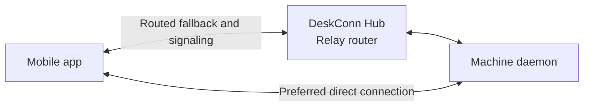

# DeskConn Mobile

Mobile client for [DeskConn](https://github.com/xconnio/deskconn).
Access your computers, open terminals, transfer files, and use remote apps from
your phone.

## Capabilities

- **Terminals:** open interactive shells on your machines.
- **Files:** browse, edit, share, upload, and download remote files.
- **Remote controls:** use supported machine apps for screen locking,
  brightness, screenshots, audio, and media playback.
- **Port forwarding:** reach a machine's TCP ports locally or expose local ports
  to the machine.
- **VPN on Android:** route the phone's traffic through a machine acting as an
  exit node. This feature requires a direct connection.
- **Accounts and access:** sign in, manage devices, and manage machine sharing.

Available tools depend on the machine's operating system and enabled apps.

## How it connects

Built with Flutter and [XConn](https://github.com/xconnio/xconn), the app attempts
a direct peer-to-peer connection by default. After two consecutive failed direct
attempts, it falls back to the Hub's routed connection.



Direct connections currently use WebRTC; routed connections use QUIC. Files,
terminals, and TCP forwarding work over either path. Settings can disable P2P,
and machine status controls let you retry a direct connection or choose routing.

## Getting started

Create an account in the app or at [web.deskconn.com](https://web.deskconn.com).
Install DeskConn on a computer and attach it to the account, then select the
machine in the app. See the [DeskConn setup guide](https://github.com/xconnio/deskconn#getting-started).

## Local development

Use Flutter 3.41 or newer with a compatible Dart SDK; CI uses Flutter 3.47.7.
Android development also requires the Android SDK and a compatible JDK.

```sh
flutter pub get
flutter devices
flutter run -d DEVICE_ID
```

XConn is installed from pub.dev with an automatic native-library download.
A Rust toolchain and sibling XConn checkout are not needed for normal builds.
See [platform setup](docs/development.md) for supported native targets,
self-hosted configuration, and Windows troubleshooting.

## Build and checks

```sh
make check-format
make lint
make test
make build-apk
```

The ARM64 APK is written to
`build/app/outputs/flutter-apk/app-release.apk`. See
[Android build and signing](docs/development.md#android) before distributing it,
and [testing](docs/testing.md) for backend interoperability tests.
